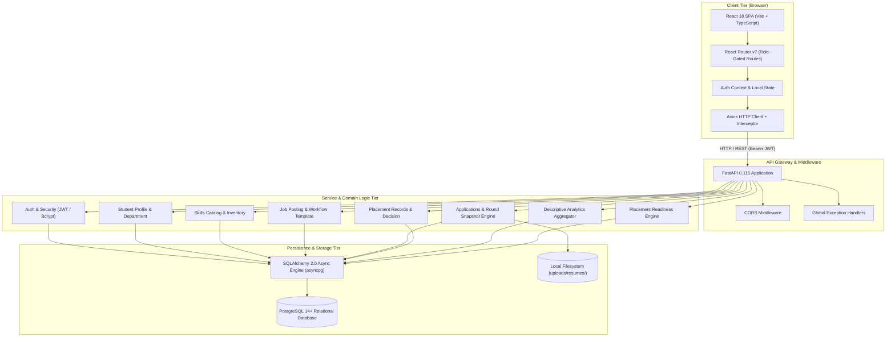
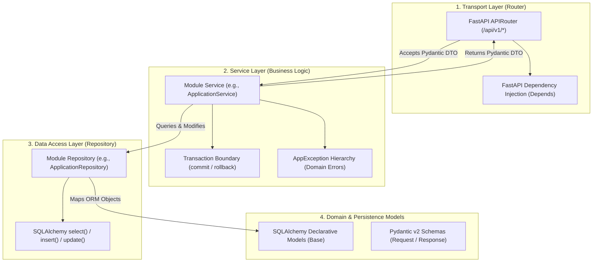
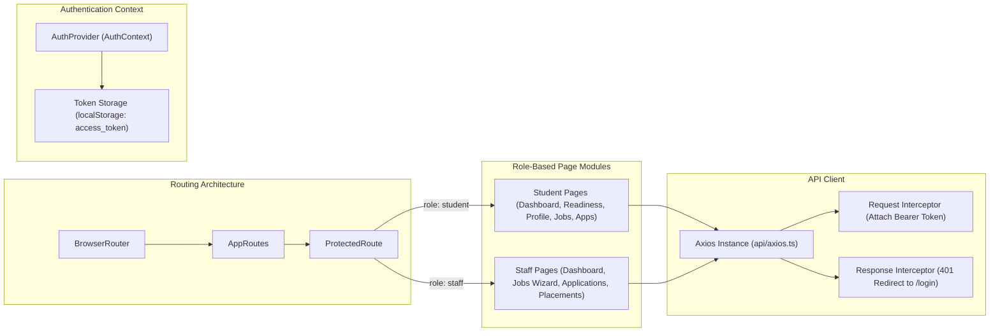
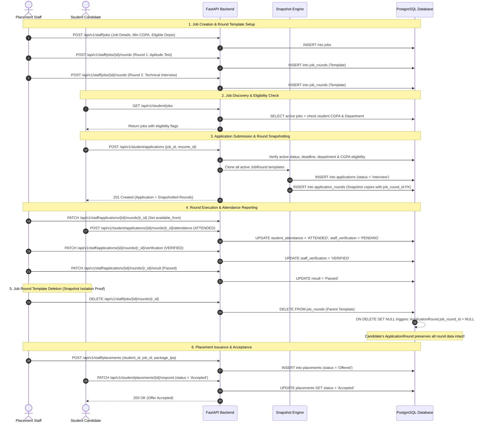
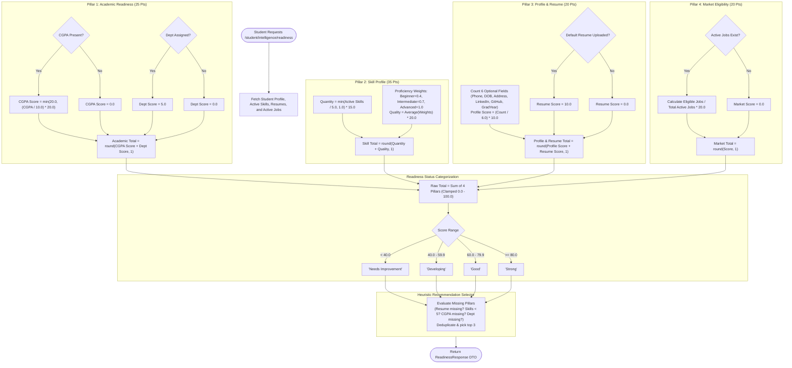

# System Architecture & Component Verification

**Project:** Career Compass AI: Smart Placement Analytics & Career Intelligence Platform  
**Component Scope:** Frontend, Backend, Database, Storage, and Security Boundaries  
**Document Status:** Source-Verified from Repository Code  

---

## 1. High-Level System Architecture

Career Compass AI follows a **decoupled, multi-tier client-server architecture** designed around clean boundaries, explicit dependency injection, and asynchronous I/O.

---

## 2. Backend Layered Architecture (Clean Architecture)

The backend follows the **Repository Pattern and Service Layer pattern** across all 13 feature modules. Each module maintains strict isolation between transport concerns, business logic, and database access.

### Layer Responsibilities & Rules
1. **Routers (`router.py`):**
   - Parse HTTP requests, path parameters, query parameters, and JSON payloads.
   - Inject dependencies (`CurrentUser`, `RequireStaff`, `RequireStudent`, `DBSession`).
   - Call the service layer; routers **never** write directly to the database or call `commit()`.
2. **Services (`service.py`):**
   - Contain business rules, eligibility validations, and snapshot creation logic.
   - Own transaction boundaries: services invoke `await session.commit()` or `await session.rollback()`.
   - Raise custom exceptions subclassing `AppException` (e.g., `NotFoundError`, `BadRequestError`, `ConflictError`, `ForbiddenError`), never raw `HTTPException`.
3. **Repositories (`repository.py`):**
   - Encapsulate all database queries using SQLAlchemy `select()`, joins, and filters.
   - Do not call `commit()`; repositories perform queries and return ORM objects or scalars.
4. **Error Handling (`app/core/error_handlers.py`):**
   - Global exception handlers catch domain `AppException` subclasses and translate them into standardized JSON error responses with appropriate HTTP status codes (400, 401, 403, 404, 409, 500).

---

## 3. Frontend Architecture & State Management

The frontend is a single-page application built on **React 18** and bundled with **Vite 5**.

### Route Protection Flow
1. User logs in at `/login` via `authService.login()`.
2. Access token is saved to `localStorage` under key `access_token`.
3. `AuthProvider` mounts, fetches `/api/v1/auth/me`, and populates `user` state.
4. `ProtectedRoute` checks:
   - If `loading`, displays full-screen loading spinner.
   - If not authenticated, redirects to `/login`.
   - If `user.role` does not match `allowedRoles`, redirects to user's assigned dashboard (`/student/dashboard` or `/staff/dashboard`).

---

## 4. End-to-End Recruitment Workflow Sequence

The recruitment cycle integrates job posting, template definition, candidate snapshotting, attendance self-reporting, staff verification, and placement creation.

---

## 5. Placement Readiness Scoring Pipeline Flowchart

The scoring engine executes a deterministic arithmetic pipeline calculating weighted readiness pillars without machine learning dependencies.

---

## 6. Security & Authentication Architecture

1. **Password Hashing:**
   - Implemented in [app/core/security.py](file:///d:/Project%20X/CareerCompassAI/backend/app/core/security.py) using `bcrypt` (version 4.2.1) with automatically generated random salts.
   - Plaintext passwords are never logged or stored.
2. **Stateless JWT Tokens:**
   - Implemented in [app/core/jwt.py](file:///d:/Project%20X/CareerCompassAI/backend/app/core/jwt.py) using `PyJWT` (version 2.10.1).
   - Algorithm: `HS256`. Default token expiry: 60 minutes (`JWT_ACCESS_TOKEN_EXPIRE_MINUTES`).
   - Payload contains `sub` (user email string) and `role` (`student` or `staff`).
3. **Role-Based Dependency Injection:**
   - [app/api/deps.py](file:///d:/Project%20X/CareerCompassAI/backend/app/api/deps.py) provides reusable FastAPI dependency guards:
     - `CurrentUser`: Validates token and returns active database `User` instance.
     - `RequireStudent`: Gated by `require_role(RoleEnum.STUDENT)`.
     - `RequireStaff`: Gated by `require_role(RoleEnum.STAFF)`.
