# Database Schema & Relational Model Verification

**Project:** Career Compass AI: Smart Placement Analytics & Career Intelligence Platform  
**RDBMS:** PostgreSQL 14+  
**ORM / Driver:** SQLAlchemy 2.0.36 (asyncio) / asyncpg 0.30.0  
**Migration Manager:** Alembic 1.14.0  
**Document Status:** Source-Verified against SQLAlchemy models and Alembic migration scripts  

---

## 1. Relational Entity-Relationship (ER) Diagram

The following diagram reflects the active PostgreSQL database schema.

```mermaid
erDiagram
    users ||--o| students : "user_id (1:1)"
    users ||--o{ application_rounds : "staff_verified_by_id (1:N)"
    departments ||--o{ students : "department_id (1:N)"
    departments ||--o{ job_eligible_departments : "department_id (1:N)"
    skills ||--o{ student_skills : "skill_id (1:N)"
    skills ||--o{ job_required_skills : "skill_id (1:N)"
    students ||--o{ student_skills : "student_id (1:N)"
    students ||--o{ resumes : "student_id (1:N)"
    students ||--o{ applications : "student_id (1:N)"
    students ||--o{ placements : "student_id (1:N)"
    companies ||--o{ jobs : "company_id (1:N)"
    companies ||--o{ placements : "company_id (1:N)"
    jobs ||--o{ job_eligible_departments : "job_id (1:N)"
    jobs ||--o{ job_required_skills : "job_id (1:N)"
    jobs ||--o{ job_rounds : "job_id (1:N)"
    jobs ||--o{ applications : "job_id (1:N)"
    jobs ||--o{ placements : "job_id (1:N)"
    resumes ||--o{ applications : "resume_id (1:N)"
    applications ||--o{ application_rounds : "application_id (1:N)"
    applications ||--o| placements : "application_id (1:1)"
    job_rounds ||--o{ application_rounds : "job_round_id (1:N, SET NULL)"

    users {
        int id PK
        string email UK
        string password_hash
        user_role role
        boolean is_active
        datetime created_at
        datetime updated_at
    }

    departments {
        int id PK
        string name UK
        string code UK
        boolean is_active
        datetime created_at
        datetime updated_at
    }

    students {
        int id PK
        int user_id FK, UK
        string register_number UK
        string full_name
        int department_id FK
        numeric cgpa
        string phone
        date date_of_birth
        string address
        string linkedin_url
        string github_url
        int graduation_year
        datetime created_at
        datetime updated_at
    }

    skills {
        int id PK
        string name UK
        string category
        boolean is_active
        datetime created_at
        datetime updated_at
    }

    student_skills {
        int id PK
        int student_id FK
        int skill_id FK
        proficiency_level proficiency
        datetime created_at
        datetime updated_at
    }

    resumes {
        int id PK
        int student_id FK
        string title
        text summary
        text objective
        string file_path
        string file_name
        string file_type
        int file_size
        boolean is_default
        datetime created_at
        datetime updated_at
    }

    companies {
        int id PK
        string name UK
        string website
        string industry
        string location
        text description
        boolean is_active
        datetime created_at
        datetime updated_at
    }

    jobs {
        int id PK
        int company_id FK
        string title
        text description
        text requirements
        string location
        string employment_type
        string work_mode
        numeric ctc_lpa
        numeric min_cgpa
        datetime application_start_at
        datetime deadline
        boolean is_active
        text instructions
        datetime created_at
        datetime updated_at
    }

    job_eligible_departments {
        int id PK
        int job_id FK
        int department_id FK
    }

    job_required_skills {
        int id PK
        int job_id FK
        int skill_id FK
        proficiency_level min_proficiency
    }

    job_rounds {
        int id PK
        int job_id FK
        int round_number
        round_type round_type
        string title
        text description
        schedule_type_enum schedule_type
        datetime available_from
        datetime available_until
        int duration_minutes
        string meeting_link
        string test_link
        text instructions
        boolean is_required
        boolean is_active
        datetime created_at
        datetime updated_at
    }

    applications {
        int id PK
        int student_id FK
        int job_id FK
        int resume_id FK
        application_status status
        datetime applied_at
        datetime updated_at
    }

    application_rounds {
        int id PK
        int application_id FK
        int round_number
        round_type round_type
        string title
        round_status status
        round_result result
        schedule_type_enum schedule_type
        datetime available_from
        datetime available_until
        datetime completed_at
        int duration_minutes
        student_attendance_enum student_attendance
        datetime student_action_at
        staff_verification_enum staff_verification
        datetime staff_verified_at
        int staff_verified_by_id FK
        datetime rescheduled_at
        string reschedule_reason
        int job_round_id FK
        text description
        string meeting_link
        string test_link
        text instructions
        string external_link
        text notes
        datetime created_at
        datetime updated_at
    }

    placements {
        int id PK
        int student_id FK
        int job_id FK
        int company_id FK
        int application_id FK
        numeric package_lpa
        string designation
        date offer_date
        placement_status status
        text student_notes
        text staff_notes
        datetime created_at
        datetime updated_at
    }
```

---

## 2. Primary Key Strategy & Historical Migration Context

All entities in the schema utilize **auto-incrementing Integer Primary Keys** (PostgreSQL `SERIAL` via SQLAlchemy default auto-increment sequence).

### Historical Design Decision
In Alembic migration `c227557a7841_create_users_table.py`, the architectural rationale is recorded:
> *"id is an auto-incrementing integer primary key (PostgreSQL SERIAL, via SQLAlchemy's default autoincrement behavior for a single-column integer PK) — a finalized project decision for this MCA mini project, in place of UUIDs."*

Reasons for this choice in this project scope:
1. **Index Efficiency & Compactness:** 4-byte integers provide fast B-Tree indexing in PostgreSQL compared to 16-byte UUIDs.
2. **Simplified URL Routing:** Clean, integer-based REST paths (e.g., `/api/v1/staff/jobs/3`).
3. **Foreign Key Performance:** High join performance across recruitment rounds, student skills, and job departments.

---

## 3. Detailed Entity Table Specifications

### 3.1 `users` Table
Stores authentication credentials and high-level role authorization.

| Column | Type | Nullable | Default | Constraints & Description |
|---|---|---|---|---|
| `id` | `INTEGER` | No | Auto-increment | Primary Key |
| `email` | `VARCHAR(255)` | No | — | Unique index (`ix_users_email`), lowercased |
| `password_hash` | `VARCHAR(255)` | No | — | Bcrypt salt + hash |
| `role` | `user_role` (Enum) | No | `'student'` | Enum values: `'student'`, `'staff'` |
| `is_active` | `BOOLEAN` | No | `true` | Soft account deactivation |
| `created_at` | `TIMESTAMPTZ` | No | `now()` | Audit creation timestamp |
| `updated_at` | `TIMESTAMPTZ` | No | `now()` | Audit update timestamp |

### 3.2 `departments` Table
Academic departments configured by placement staff.

| Column | Type | Nullable | Default | Constraints & Description |
|---|---|---|---|---|
| `id` | `INTEGER` | No | Auto-increment | Primary Key |
| `name` | `VARCHAR(100)` | No | — | Unique constraint (`uq_departments_name`) |
| `code` | `VARCHAR(20)` | No | — | Unique constraint (`uq_departments_code`), e.g., 'MCA', 'CSE' |
| `is_active` | `BOOLEAN` | No | `true` | Active status toggle |
| `created_at` | `TIMESTAMPTZ` | No | `now()` | Creation timestamp |
| `updated_at` | `TIMESTAMPTZ` | No | `now()` | Update timestamp |

### 3.3 `students` Table
Comprehensive student profile and academic metrics.

| Column | Type | Nullable | Default | Constraints & Description |
|---|---|---|---|---|
| `id` | `INTEGER` | No | Auto-increment | Primary Key |
| `user_id` | `INTEGER` | No | — | Foreign Key (`users.id`, `ON DELETE CASCADE`), Unique |
| `register_number` | `VARCHAR(50)` | Yes | — | Unique constraint (`uq_students_register_number`) |
| `full_name` | `VARCHAR(100)` | Yes | — | Candidate's display name |
| `department_id` | `INTEGER` | Yes | `NULL` | Foreign Key (`departments.id`, `ON DELETE SET NULL`) |
| `cgpa` | `NUMERIC(4, 2)` | Yes | `NULL` | Grade point average (range: 0.00 to 10.00) |
| `phone` | `VARCHAR(20)` | Yes | — | Contact telephone number |
| `date_of_birth` | `DATE` | Yes | — | Candidate date of birth |
| `address` | `TEXT` | Yes | — | Physical mailing address |
| `linkedin_url` | `VARCHAR(255)` | Yes | — | Validated HTTP/HTTPS LinkedIn profile URL |
| `github_url` | `VARCHAR(255)` | Yes | — | Validated HTTP/HTTPS GitHub profile URL |
| `graduation_year`| `INTEGER` | Yes | — | Expected year of graduation (e.g., 2026) |
| `created_at` | `TIMESTAMPTZ` | No | `now()` | Audit creation timestamp |
| `updated_at` | `TIMESTAMPTZ` | No | `now()` | Audit update timestamp |

### 3.4 `skills` Table & `student_skills` Table
Master skill repository and per-student inventory with proficiency ratings.

- **`skills` Columns:** `id` (PK), `name` (VARCHAR(100), Unique), `category` (VARCHAR(50), e.g. "Programming Languages", "Databases"), `is_active` (BOOLEAN, default true), `created_at`, `updated_at`.
- **`student_skills` Columns:** `id` (PK), `student_id` (FK `students.id`, `ON DELETE CASCADE`), `skill_id` (FK `skills.id`, `ON DELETE CASCADE`), `proficiency` (Enum: `'beginner'`, `'intermediate'`, `'advanced'`), `created_at`, `updated_at`.
- **Constraint:** Unique composite key `uq_student_skills_student_skill (student_id, skill_id)`. Note: Migration `38f0da1163aa` permanently removed `'expert'` from the system.

### 3.5 `resumes` Table
Multi-resume document storage and structured metadata.

| Column | Type | Nullable | Default | Constraints & Description |
|---|---|---|---|---|
| `id` | `INTEGER` | No | Auto-increment | Primary Key |
| `student_id` | `INTEGER` | No | — | Foreign Key (`students.id`, `ON DELETE CASCADE`) |
| `title` | `VARCHAR(100)` | No | — | Student-defined resume label |
| `summary` | `TEXT` | Yes | — | Optional professional summary |
| `objective` | `TEXT` | Yes | — | Optional career objective |
| `file_path` | `VARCHAR(500)` | Yes | — | Local filesystem path under `uploads/resumes/` |
| `file_name` | `VARCHAR(255)` | Yes | — | Original uploaded file name |
| `file_type` | `VARCHAR(50)` | Yes | — | Validated MIME type (PDF/DOC/DOCX) |
| `file_size` | `INTEGER` | Yes | — | File size in bytes (enforced $\le 5$ MB) |
| `is_default` | `BOOLEAN` | No | `false` | Default resume flag for 1-click applications |
| `created_at` | `TIMESTAMPTZ` | No | `now()` | Upload timestamp |
| `updated_at` | `TIMESTAMPTZ` | No | `now()` | Update timestamp |

### 3.6 `companies` Table & `jobs` Table
- **`companies`:** `id` (PK), `name` (VARCHAR(150), Unique), `website` (VARCHAR(255)), `industry` (VARCHAR(100)), `location` (VARCHAR(150)), `description` (TEXT), `is_active` (BOOLEAN, default true), `created_at`, `updated_at`.
- **`jobs`:** `id` (PK), `company_id` (FK `companies.id`, `ON DELETE CASCADE`), `title` (VARCHAR(150)), `description` (TEXT), `requirements` (TEXT), `location` (VARCHAR(150)), `employment_type` (VARCHAR(50), e.g. Full-time, Internship), `work_mode` (VARCHAR(50), e.g. On-site, Remote, Hybrid), `ctc_lpa` (NUMERIC(6,2)), `min_cgpa` (NUMERIC(4,2)), `application_start_at` (TIMESTAMPTZ), `deadline` (TIMESTAMPTZ), `is_active` (BOOLEAN, default true), `instructions` (TEXT), `created_at`, `updated_at`.
- **Job Junction Tables:**
  - `job_eligible_departments`: `(job_id, department_id)` both cascade on delete; composite unique constraint `uq_job_eligible_dept`.
  - `job_required_skills`: `(job_id, skill_id, min_proficiency)` both cascade on delete; composite unique constraint `uq_job_required_skill`.

### 3.7 `job_rounds` Table (Workflow Templates)
Defines recruitment round templates for a job posting.

| Column | Type | Nullable | Default | Constraints & Description |
|---|---|---|---|---|
| `id` | `INTEGER` | No | Auto-increment | Primary Key |
| `job_id` | `INTEGER` | No | — | Foreign Key (`jobs.id`, `ON DELETE CASCADE`) |
| `round_number` | `INTEGER` | No | — | Sequence number (1, 2, 3...) |
| `round_type` | `round_type` (Enum)| No | — | e.g., 'Online Assessment', 'Technical Interview' |
| `title` | `VARCHAR(150)`| Yes | — | Descriptive round title |
| `schedule_type` | `schedule_type_enum`| No | `'FIXED_TIME'`| `'FIXED_TIME'` or `'AVAILABILITY_WINDOW'` |
| `available_from`| `TIMESTAMPTZ`| Yes | — | Start time or fixed interview date |
| `available_until`| `TIMESTAMPTZ`| Yes | — | Window expiry (required if AVAILABILITY_WINDOW) |
| `duration_minutes`| `INTEGER` | No | `60` | Scheduled duration in minutes |
| `meeting_link` | `VARCHAR(500)`| Yes | — | Video conference URL |
| `test_link` | `VARCHAR(500)`| Yes | — | Online coding/assessment link |
| `instructions` | `TEXT` | Yes | — | Round guidelines for candidates |
| `is_required` | `BOOLEAN` | No | `true` | Mandatory round flag |
| `is_active` | `BOOLEAN` | No | `true` | Active round flag |
| `created_at` | `TIMESTAMPTZ` | No | `now()` | Creation timestamp |
| `updated_at` | `TIMESTAMPTZ` | No | `now()` | Update timestamp |

**Constraint:** Composite unique key `uq_job_rounds_job_id_round_num (job_id, round_number)`.

### 3.8 `applications` Table
Candidate job applications.

| Column | Type | Nullable | Default | Constraints & Description |
|---|---|---|---|---|
| `id` | `INTEGER` | No | Auto-increment | Primary Key |
| `student_id` | `INTEGER` | No | — | Foreign Key (`students.id`, `ON DELETE CASCADE`) |
| `job_id` | `INTEGER` | No | — | Foreign Key (`jobs.id`, `ON DELETE CASCADE`) |
| `resume_id` | `INTEGER` | No | — | Foreign Key (`resumes.id`, `ON DELETE RESTRICT`) |
| `status` | `application_status`| No | `'Pending'` | Enum: `'Pending'`, `'Reviewing'`, `'Interview'`, `'Offered'`, `'Rejected'`, `'Withdrawn'` |
| `applied_at` | `TIMESTAMPTZ` | No | `now()` | Submission timestamp |
| `updated_at` | `TIMESTAMPTZ` | No | `now()` | Status transition timestamp |

**Constraint:** `uq_applications_student_id_job_id (student_id, job_id)` prevents duplicate applications.

### 3.9 `application_rounds` Table (Candidate Round Snapshots)
Per-application round tracking instances.

| Column | Type | Nullable | Default | Constraints & Description |
|---|---|---|---|---|
| `id` | `INTEGER` | No | Auto-increment | Primary Key |
| `application_id` | `INTEGER` | No | — | Foreign Key (`applications.id`, `ON DELETE CASCADE`) |
| `round_number` | `INTEGER` | No | — | Round order within this application |
| `round_type` | `round_type` (Enum)| No | — | Copied from JobRound template |
| `title` | `VARCHAR(150)`| Yes | — | Copied from JobRound template |
| `status` | `round_status` (Enum)| No | `'Not Started'` | `'Not Started'`, `'Scheduled'`, `'In Progress'`, `'Completed'`, `'Cancelled'` |
| `result` | `round_result` (Enum)| Yes | `NULL` | `'Pending'`, `'Passed'`, `'Failed'`, `'Not Attended'` |
| `schedule_type` | `schedule_type_enum`| No | `'FIXED_TIME'`| Copied from template |
| `available_from`| `TIMESTAMPTZ`| Yes | — | Scheduled date/time |
| `available_until`| `TIMESTAMPTZ`| Yes | — | Window close date/time |
| `completed_at` | `TIMESTAMPTZ`| Yes | — | Actual completion timestamp |
| `duration_minutes`| `INTEGER` | No | `60` | Duration in minutes |
| `student_attendance`| `student_attendance_enum`| No| `'NOT_REPORTED'`| `'NOT_REPORTED'`, `'ATTENDED'`, `'ABSENT'` |
| `student_action_at`| `TIMESTAMPTZ`| Yes| — | Timestamp of candidate attendance action |
| `staff_verification`| `staff_verification_enum`| No| `'PENDING'`| `'PENDING'`, `'VERIFIED'`, `'REJECTED'` |
| `staff_verified_at`| `TIMESTAMPTZ`| Yes| — | Timestamp of staff verification |
| `staff_verified_by_id`| `INTEGER` | Yes| `NULL` | Foreign Key (`users.id`, `ON DELETE SET NULL`) |
| `rescheduled_at`| `TIMESTAMPTZ`| Yes | — | Timestamp when rescheduled |
| `reschedule_reason`| `VARCHAR(255)`| Yes| — | Mandatory staff justification |
| `job_round_id` | `INTEGER` | Yes | `NULL` | **Foreign Key (`job_rounds.id`, `ON DELETE SET NULL`)** |
| `description` | `TEXT` | Yes | — | Copied from JobRound template |
| `meeting_link` | `VARCHAR(500)`| Yes | — | Copied / edited meeting link |
| `test_link` | `VARCHAR(500)`| Yes | — | Copied / edited test link |
| `instructions` | `TEXT` | Yes | — | Copied instructions |
| `external_link`| `VARCHAR(500)`| Yes | — | Ad-hoc external link |
| `notes` | `TEXT` | Yes | — | Staff evaluation notes |
| `created_at` | `TIMESTAMPTZ` | No | `now()` | Snapshot creation timestamp |
| `updated_at` | `TIMESTAMPTZ` | No | `now()` | Last update timestamp |

**Constraint:** Composite unique key `uq_application_rounds_app_id_round_num (application_id, round_number)`.

### 3.10 `placements` Table
Formal job offer records and student acceptance outcomes.

| Column | Type | Nullable | Default | Constraints & Description |
|---|---|---|---|---|
| `id` | `INTEGER` | No | Auto-increment | Primary Key |
| `student_id` | `INTEGER` | No | — | Foreign Key (`students.id`, `ON DELETE CASCADE`) |
| `job_id` | `INTEGER` | No | — | Foreign Key (`jobs.id`, `ON DELETE CASCADE`) |
| `company_id` | `INTEGER` | No | — | Foreign Key (`companies.id`, `ON DELETE CASCADE`) |
| `application_id`| `INTEGER` | Yes | `NULL` | Foreign Key (`applications.id`, `ON DELETE SET NULL`) |
| `package_lpa` | `NUMERIC(6, 2)`| Yes| — | Compensation package in LPA |
| `designation` | `VARCHAR(150)`| Yes| — | Offered job title |
| `offer_date` | `DATE` | Yes | `current_date` | Date of offer issuance |
| `status` | `placement_status`| No | `'Offered'` | Enum: `'Offered'`, `'Accepted'`, `'Declined'`, `'Revoked'` |
| `student_notes`| `TEXT` | Yes | — | Notes provided on student response |
| `staff_notes` | `TEXT` | Yes | — | Staff remarks |
| `created_at` | `TIMESTAMPTZ` | No | `now()` | Creation timestamp |
| `updated_at` | `TIMESTAMPTZ` | No | `now()` | Last update timestamp |

**Constraint:** `uq_placements_student_job (student_id, job_id)`.

---

## 4. Foreign Key Deletion Behaviors & Snapshot Safety

| Foreign Key | Parent Table | Child Table | Deletion Rule | Rationale |
|---|---|---|---|---|
| `user_id` | `users` | `students` | `CASCADE` | Student profile is co-owned by User login entity |
| `department_id` | `departments` | `students` | `SET NULL` | Deleting a department does not delete enrolled students |
| `resume_id` | `resumes` | `applications` | `RESTRICT` | Cannot delete a resume attached to an active application |
| `company_id` | `companies` | `jobs` | `CASCADE` | Deleting a company removes associated job postings |
| `job_id` | `jobs` | `job_rounds` | `CASCADE` | Job rounds are direct sub-components of a job posting |
| `job_round_id` | `job_rounds` | `application_rounds`| **`SET NULL`** | **Deleting a template round does NOT delete candidate rounds (Snapshot Isolation)** |
| `staff_verified_by_id` | `users` | `application_rounds`| `SET NULL` | Deleting a staff account preserves verification history |
| `application_id`| `applications` | `placements` | `SET NULL` | Placement record preserved even if application archived |

---

## 5. Complete Chronological Migration History

The schema evolved through **17 successive Alembic migrations**:

1. `c227557a7841`: `create_users_table` (Initial users table with integer PK and `user_role` enum).
2. `2ebd1e570480`: `create_departments_and_students_tables` (Departments and student profiles).
3. `70466c0ad0bf`: `create_skills_and_student_skills_tables` (Master skills and proficiency tracking).
4. `38f0da1163aa`: `remove_expert_proficiency_level` (Standardized proficiency to beginner/intermediate/advanced).
5. `04b4acaa5c64`: `create_resumes_table` (Initial structured resume table).
6. `995c78159606`: `add_resume_file_metadata_columns` (File metadata support: path, size, type).
7. `a1b2c3d4e5f6`: `refactor_resume_multiple_documents` (Multi-resume support with default flag).
8. `b2c3d4e5f6a7`: `rename_admin_role_to_staff` (PostgreSQL enum migration: renamed `'admin'` to `'staff'`).
9. `c3d4e5f6a7b8`: `add_is_active_to_departments_and_skills` (Soft active flags for catalog entries).
10. `d4e5f6a7b8c9`: `create_companies_table` (Recruiting corporate directory).
11. `e5f6a7b8c9d0`: `create_jobs_tables` (Jobs, department eligibility, and required skills junction tables).
12. `dd9cdd2a8b78`: `add_applications_table` (Student job applications with duplicate prevention).
13. `5691ad76ea38`: `add_placements_table` (Placement offers, acceptance states, and compensation).
14. `81798731b236`: `add_application_rounds` (Initial round tracking on applications).
15. `c2d3e4f5a6b7`: `create_job_rounds_table` (Job-level recruitment round workflow templates).
16. `b1c2d3e4f5a6`: `add_round_schedule_type_and_availability_window` (Availability windows & fixed time scheduling).
17. `9a8b7c6d5e4f`: `enhance_recruitment_workflow` (Attendance reporting, staff verification, rescheduling reasons).
